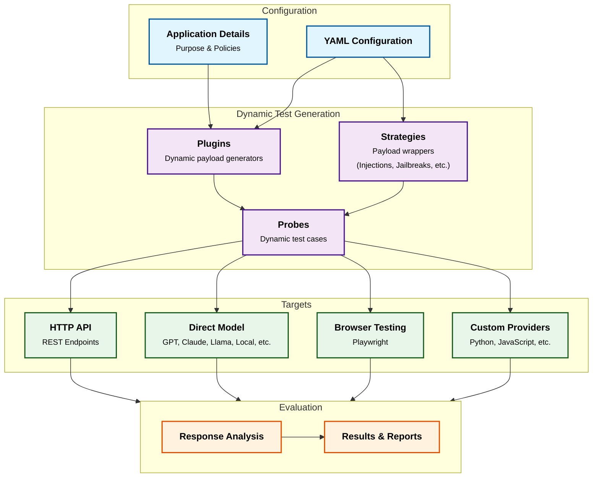
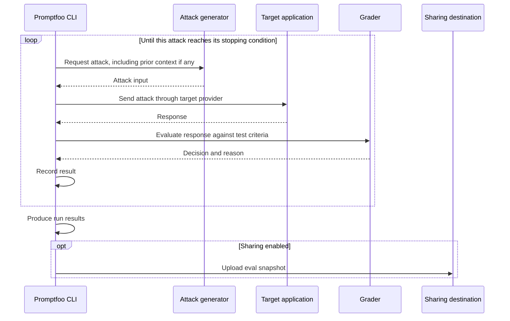

# Architecture

A red team run generates attacks, sends them to your target, and grades the responses. **Plugins** define what to test, **strategies** define how to attack, and **providers** connect to the target and any models used for generation or grading.

For a first run, follow the [quickstart guide](/docs/red-team/quickstart).

## Core Components

### Test Generation Engine

The test generation engine combines plugins and strategies to create attack probes:

- **[Plugins](/docs/red-team/plugins)** generate adversarial inputs for specific vulnerability types. Each plugin is a self-contained module that can be enabled or disabled through configuration.

  Examples include [PII exposure](/docs/red-team/plugins/pii/), [BOLA](/docs/red-team/plugins/bola/), and [Hate Speech](/docs/red-team/plugins/harmful/).

- **[Strategies](/docs/red-team/strategies/)** are patterns for delivering the generated adversarial inputs.

  The most fundamental strategy is `basic`, which controls whether original test cases are included in the output. When disabled, only modified test cases from other strategies are included.

  Other strategies range from simple encodings like [base64](/docs/red-team/strategies/base64/) or [leetspeak](/docs/red-team/strategies/leetspeak/) to more complex implementations like [Microsoft's multi-turn attacks](/docs/red-team/strategies/multi-turn/) and [Meta's GOAT framework](/docs/red-team/strategies/goat/).

- **Attack Probes** are the natural language prompts generated by combining plugins and strategies.

  They contain the actual test inputs along with metadata about the intended vulnerability test. Promptfoo sends these to your target system.

### Target Interface

Choose a [provider](/docs/providers/) that can send the test input to your application and return the response to be graded:

- **[HTTP API](/docs/providers/http/)** - Tests REST endpoints via configurable requests
- **[Direct Model](/docs/red-team/configuration/#custom-providerstargets)** - Interfaces with LLM providers like OpenAI or local models
- **[Browser](/docs/providers/browser/)** - Runs browser interactions using Playwright
- **[Custom Provider](/docs/red-team/configuration/#providers)** - Implements custom runtime integrations via Python/JavaScript

Each target type implements a common interface for sending probes and receiving responses.

### Evaluation Engine

Each test's assertions check the target response against the plugin's criteria and application context. Many red team checks use an LLM grader. Results include the attack, response, pass/fail decision, and grading reason.

A request or grading error means the check could not complete. It should not be interpreted as a successful defense. See [grading results](/docs/red-team/troubleshooting/grading-results) for how to review and customize these judgments.

### Configuration

Configuration ties the components together via `promptfooconfig.yaml`. See [configuration guide](/docs/red-team/configuration) for details.

The configuration defines:

- Target endpoints and authentication
- [Enabled plugins](/docs/red-team/configuration/#plugins) and their settings
- [Active strategies](/docs/red-team/configuration/#strategies)
- Application context and [policies](/docs/red-team/configuration/#custom-policies)

## Component Flow

1. **Configuration** initializes **plugins** and **strategies**
2. **Test engine** generates probes using enabled components
3. **Target interface** delivers probes to the system
4. **Evaluation engine** analyzes responses and reports findings

You can generate tests once with `promptfoo redteam generate` and run the saved configuration with `promptfoo redteam eval`. This lets you compare target changes using the same generated cases.

For CI/CD integration, see our [automation guide](/docs/integrations/ci-cd).

## Data Flow

The diagram below shows one iterative attack. The strategy uses responses from earlier attempts to generate follow-ups. Finding a violation can end that attack's search while the remaining tests continue. Each strategy defines its own stopping conditions.

Generation and grading may use Promptfoo remote services or configured model providers. The target receives attack inputs through its provider. Running the CLI locally does not make these services local. See [generation configuration](/docs/red-team/configuration#remote-generation) and [grader configuration](/docs/red-team/troubleshooting/grading-results#using-local-providers-for-grading) to choose where those requests go.

Saving results locally and uploading them are separate operations. Sharing can be enabled by CLI flags, configuration, or a Cloud login. See [sharing](/docs/usage/sharing) for the data included and destination settings. Use `--no-share` to disable uploads for a run.
